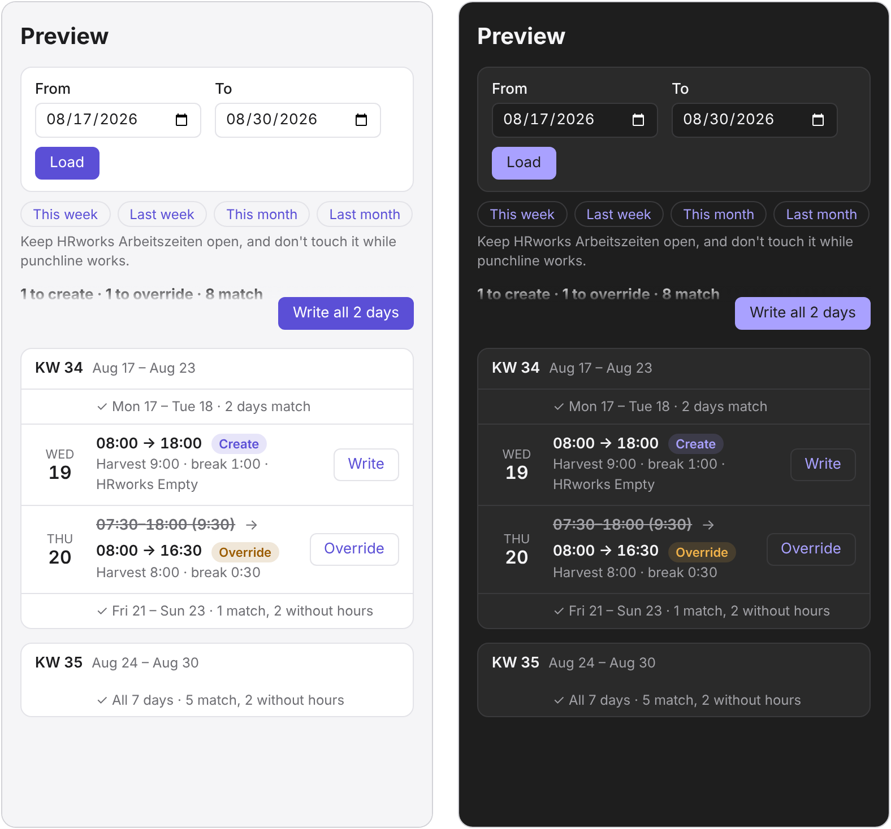
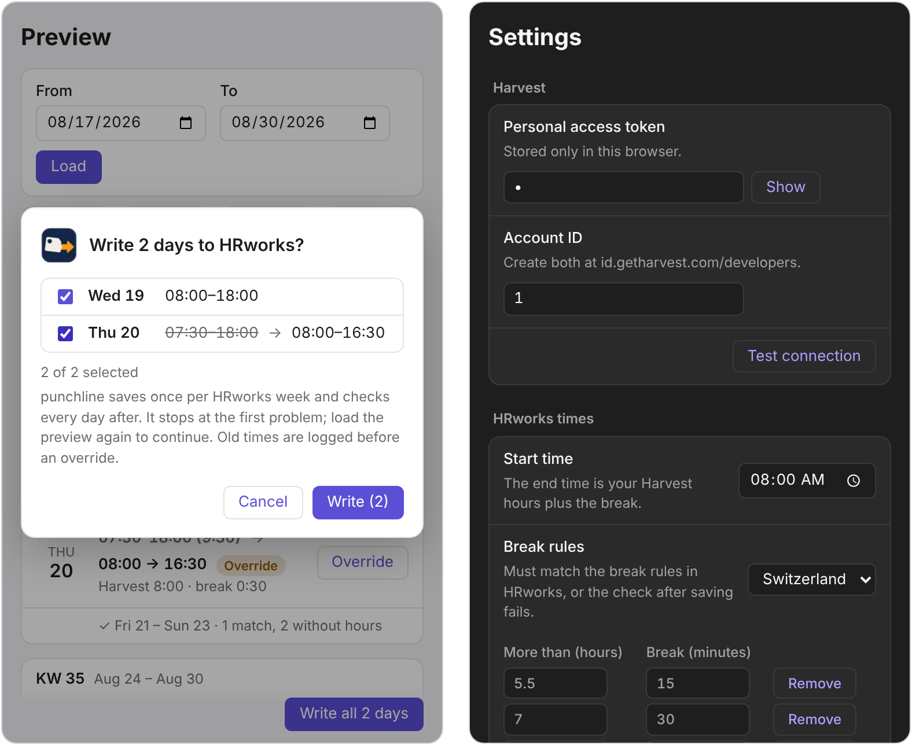

# punchline


**Your Harvest hours, punched into HRworks. One click.**

punchline is a Chrome extension that syncs daily working hours from Harvest (the source of
truth) into HRworks. Instead of clicking through HRworks day by day, you pick a date range,
check a preview and hit run.

> **Status:** internal tool, work in progress.

<p align="center">
  
</p>

## Why

We book project time in Harvest for billing. HRworks needs the same hours as clock-in and
clock-out times, with mandatory breaks on top. Keeping both in sync by hand is slow and
error-prone, especially if you're a few hundred days behind.

## How it works

1. Reads your daily totals from the Harvest API.
2. Adds the mandatory breaks, which gives a start and end time for each day.
3. Compares each day with what's already in HRworks (net hours, after breaks).
4. Shows a preview of what it's going to do.
5. Fills in the HRworks forms in your logged-in browser session, one day at a time, and
   verifies every save.

HRworks is driven through its web UI. punchline never touches your HRworks login. It uses the
session you're already in.

### Per-day rules

| HRworks state              | Action                     |
| -------------------------- | -------------------------- |
| No entry                   | Create it                  |
| Entry matches Harvest      | Skip                       |
| Entry differs from Harvest | Flag (default) or Override |
| No Harvest hours that day  | Nothing                    |

Override mode logs the old HRworks values before changing anything, since HRworks has no undo.

### Date options

- Fill all missing days
- From–to range
- Single day

## Install

Free, from a zip file: download `punchline-<version>.zip` from the
[latest release](https://github.com/gruesomeparty/punchline/releases/latest), unzip it to a
folder you keep, and load it on `chrome://extensions` with **Developer mode** and **Load
unpacked**. The [install guide](docs/install.md) has every step, updating, troubleshooting, and a
section an AI assistant can follow to set it up for you.

Maintainers: releases (release-please) and the store listing are described in
[docs/chrome-web-store.md](docs/chrome-web-store.md).

## Development setup

Requires [Node.js](https://nodejs.org/) 24 and
[gitleaks](https://github.com/gitleaks/gitleaks#installing).

1. Clone and build:

   ```sh
   git clone https://github.com/gruesomeparty/punchline.git
   cd punchline
   npm run setup
   npm run build
   ```
2. Open `chrome://extensions`, turn on **Developer mode**, click **Load unpacked** and select
   the `dist/` folder.
3. Open punchline's settings and enter:
   - your Harvest personal access token
   - your Harvest Account ID

   Both are available at Harvest → Developers → Personal Access Tokens. They're stored locally
   in your browser only.
4. Log in to HRworks as usual.

## Usage

1. Open HRworks Arbeitszeiten and stay logged in.
2. Click the punchline icon and open the preview, in Chrome's side panel by default.
3. Pick your dates. Days that already match fold away, so you only see what needs action.
4. Write one day, or Write all and untick any day you want to leave out. If anything looks off
   (a mismatch, an unexpected page, an expired session), punchline stops and tells you why. Runs
   can be resumed.

<p align="center">
  
</p>

_Screenshots use made-up data._

## Safeguards

- Preview before any write
- Read-back verification after each save
- Resumable progress, no day written twice
- Log of previous values before overriding
- Hard stop on anything unexpected
- Host access limited to the Harvest API and HRworks, enforced in CI

## Repo layout

```
.
├── src/          # The Chrome extension (manifest, service worker, popup, icons)
├── assets/       # Repo artwork: banner, 1024px icon master (not shipped)
├── scripts/      # Build, packaging and policy checks
├── docs/         # Shareable documentation (Markdown only)
├── CLAUDE.md     # Context and conventions for coding agents
└── CONTRIBUTING.md
```

## Privacy

This repository is public. Recordings, HAR files, HTML snapshots, screenshots and anything else
containing personal HR data or session info live in a separate private repository
(`punchline-internal`) and never here. See [`docs/README.md`](docs/README.md).

A pre-commit hook and CI block these file types and secrets. **Never commit Harvest tokens.**
If one leaks, revoke it in Harvest right away.

## Contributing

See [CONTRIBUTING.md](CONTRIBUTING.md). Security issues: see [SECURITY.md](SECURITY.md).

## License

[MIT](LICENSE)
